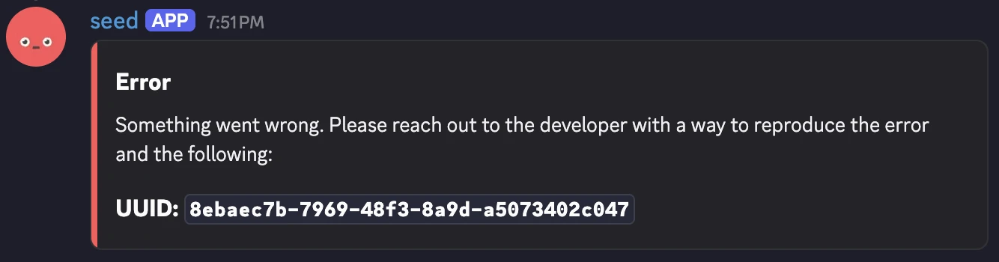

This post has one of every block a post can use.

## A heading

A paragraph with `inline code`, a [link to the guide](https://seedcord.org/guide), and some **bold text**. A second sentence to fill the line out a little further.

### A smaller heading

#### The smallest heading

- the first item in a list
- a second item with `code` in it
- a _third_ item

1. a ~~numbered~~ step
    1. a nested step
    2. another nested step
2. another step
    - a nested bullet point
    - another nested bullet point
        1. a deeply nested numbered step
            - a deeply nested bullet point

```ts title="src/handlers/SearchHandler.ts"
import { SlashRoute, SlashHandler } from '@seedcord/gateway';

@SlashRoute('search')
export class SearchHandler extends SlashHandler<'search'> {
    public async execute(): Promise<void> {
        const category = this.options.getString('category');

        await this.reply(`Searching ${category}`);
    }
}
```

```sh
pnpm create seedcord
```

> A blockquote with a sentence in it.



{/* prettier-ignore-start */}

| column | another column |
| --- | --- |
| a cell | `code` |
| another cell | more text |

{/* prettier-ignore-end */}

---

That's the end of the sample.
